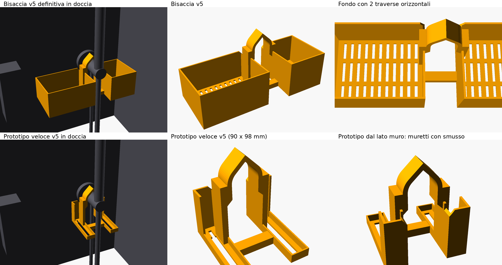

# Shower Products Holder

A 3D-printed caddy for shampoo and shower products. It hangs on the chrome **hand-shower wall outlet** (the round fitting that holds the hand shower), so it needs no drilling, screws or adhesive.

It was designed in parametric **OpenSCAD**, refined through five versions and several quick test prints, and printed in PLA+ on a **Tronxy XY-3 SE**.



> Labels inside the renders and comments inside the `.scad` files are in Italian, the language the project was developed in. Everything else in this repository is in English.

## What it does

- A **teardrop-shaped hook** sits on top of the 30.6 mm fitting, between the wall rosette and the hand-shower holder. It needs no supports to print and centres itself on two 45° contact lines.
- Two compartments hang under the fitting: a large one on the left (about 118 × 80 mm inside) and a smaller one on the right (about 68 × 80 mm) that reaches the side wall of the shower.
- A **central gap** leaves room for the two hoses below the fitting. The hand shower can still be lifted out and put back.
- A **floor-level spacer** behind the hand-shower hose ties the two compartments together. Without it, the compartments swing towards each other under load (see [structural analysis](docs/04-structural-analysis.md)).
- The back edge of the base rests against the tiles and the right side touches the side wall. The fitting only carries the weight; the walls take the turning forces.
- Slotted floors with two crossbars let water drain out.

| | Final version (v5) |
|---|---|
| Overall size | 240 × 98 × 107 mm |
| Capacity | 2–4 bottles; design target 1.5 kg; recommended 2–3 kg per compartment in PLA |
| Print time | about 17 h (0.24 mm layers, 6 walls, 20 % infill) |
| Material | about 69 m of 1.75 mm PLA+ (Cura estimate 206 g; measured 190 g) |
| Supports | none |

## Repository layout

```
models/
  v0-original-idea/   first sketch made before the project started (bathroom_first_idea.stl)
  v1/ … v5/           OpenSCAD source, exported STLs and renders for every version
gcode/                Cura G-code actually sent to the printer (v2, v4, v5 prototypes and v5 final)
tools/                Python scripts used for checks: printability, collisions, G-code analysis, beam model
scan/                 Scaniverse phone scan of the shower (OBJ + texture) used for the first estimates
photos/
  site/               the real fitting with the hand shower in place
  drawings/           hand-drawn change requests marked on renders and screenshots
  prints/             photos of the real prints
docs/                 the full story, decisions, mistakes and print settings
```

## Documentation

1. [Requirements and measurements](docs/01-requirements-and-measurements.md): what had to be held, what was measured and what was only estimated.
2. [Design history v0 → v5](docs/02-design-history.md): every version, what changed and why.
3. [Mistakes and lessons learned](docs/03-mistakes-and-lessons.md): everything that went wrong, in modelling, in communication and in printing.
4. [Structural analysis](docs/04-structural-analysis.md): the 2D beam model and why the spacer exists.
5. [Printing](docs/05-printing.md): slicer settings, G-code checks, test prints and the quality of the final print.
6. [Tools](docs/06-tools.md): what each script in `tools/` does.

## Printing it yourself

The fitting, walls and hoses in this design are measured for one specific shower, so the model will only fit yours after you change the measurements.

1. Install [OpenSCAD](https://openscad.org/) and open `models/v5/shower_holder_v5.scad`.
2. Edit the measurements at the top of the file. The main ones are:
   - `tubo_d`: fitting diameter;
   - `rosetta_sp` and `rosetta_d`: rosette thickness and diameter;
   - `att_da`/`att_a` and `doc_da`/`doc_a`: where the two hoses leave the fitting;
   - `angolo_x`: distance from the fitting axis to the side wall.
3. Set `design = "stampa_rapido";` and export a quick prototype first: it contains only the hook, the columns and the spacer, and prints in under 3 hours. Check the fit, then set `design = "stampa_bisaccia";` for the full part.
4. The `stampa_*` exports are already rotated to fit a 255 × 255 mm bed. Print them as they are, without supports. See [docs/05-printing.md](docs/05-printing.md) for settings.

## Status

- **v5 final printed** on 16–17 November 2026: it printed successfully, with some corner warping (see [printing notes](docs/05-printing.md#final-print-quality)).
- Photos of the installed caddy will be added to `photos/`.
