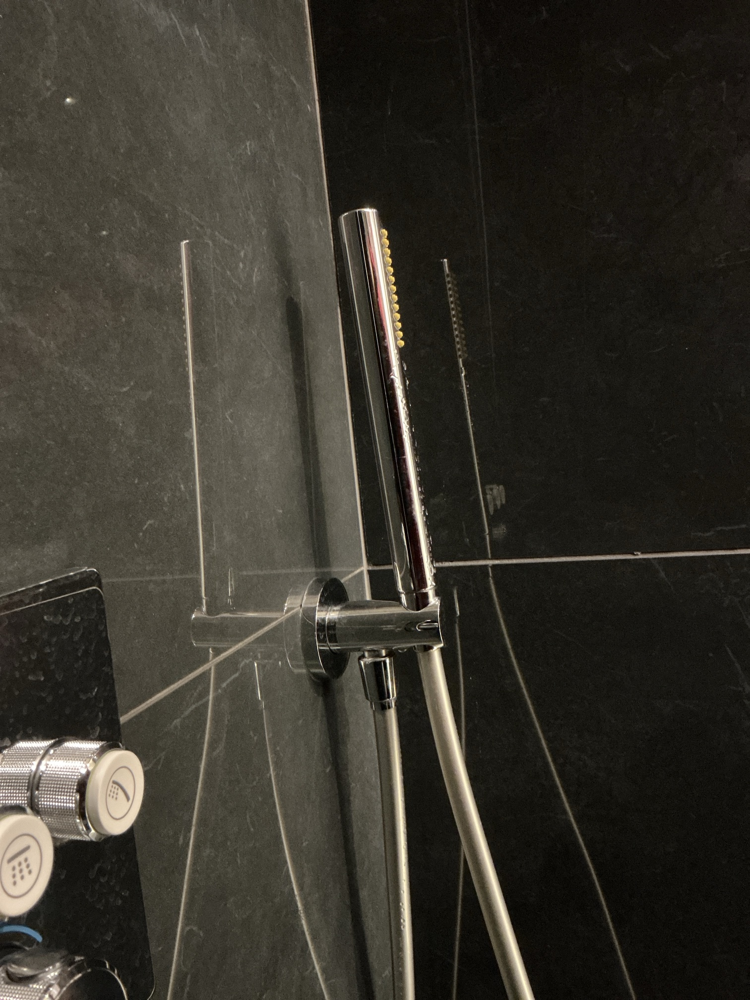

# 1. Requirements and measurements

## The problem

The shower has no shelf. The only fixed object near a comfortable height is the chrome wall outlet of the hand shower: a round fitting about 8 cm long that comes out of a wall rosette. The hand shower stands upright in a holder at the tip of the fitting, and two hoses hang below it.

## Requirements

- Hold **2–4 bottles** of shampoo and shower products, with a target load of **1.5 kg**.
- Hang from the fitting without drilling or glue, and come off easily.
- Leave the hand shower usable: it must lift out of its holder and go back without touching the caddy.
- Leave the two hoses below the fitting free.
- Fit on the printer bed: Tronxy XY-3 SE, 255 × 255 mm. The firmware limits are X/Y 0–255 and Z 0–260.
- Drain water: no closed floors.

## How the measurements were obtained

The project started from a **phone scan** of the shower (Scaniverse, 28 October 2026, in `scan/`). The scan gave a good idea of the layout, but chrome and glass scan badly, so every important size was then measured by hand or found by test printing.

| Quantity | Value used in v5 | Source |
|---|---|---|
| Fitting diameter | **30.6 mm** (circumference 96 mm) | Measured by wrapping a strip of paper around the fitting; confirmed by the v1 hook test and the v2 prototype |
| Wall to fitting axis | about 80 mm | Hand measurement |
| Rosette diameter | 60 mm | Estimated from the scan |
| Rosette thickness from the wall | **11 mm** | First estimated at 8 mm; corrected after the v2 prototype, whose back feet stopped 3 mm short of the tiles |
| 1st hose (water inlet, below the fitting) | **16–26 mm** from the rosette face | Hand measurement |
| 2nd hose (hand-shower hose, rising into the holder) | **52–66 mm** from the rosette face | Hand measurement |
| Fitting axis to right side wall | **96 mm** | First estimated at 80 mm from the scan; the v2 prototype was 16 mm short |
| Thermostatic mixer on the left | about 185–190 mm from the axis | Estimated from the scan |
| Hand-shower diameter, end of fitting | 24 mm, 72 mm | Estimates (only used for clearance checks) |

## Coordinate system used in all models

In every `.scad` file:

- **X** runs along the wall, positive towards the right-hand corner.
- **Y** comes out of the wall towards the user; the wall is at Y = 0.
- **Z** is vertical.

The fitting axis is at X = 0, Z = 0. The `stampa_*` ("print") variants are the same parts rotated 90° about Z so that the 240 mm length runs along the printer's Y axis.
