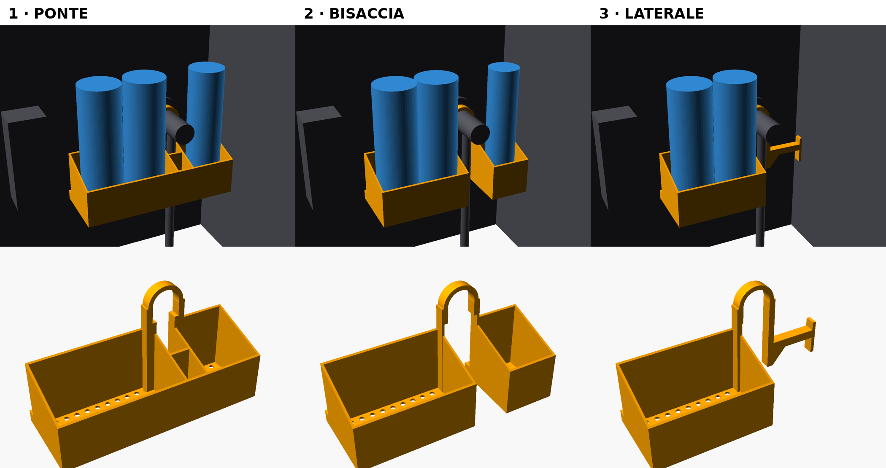
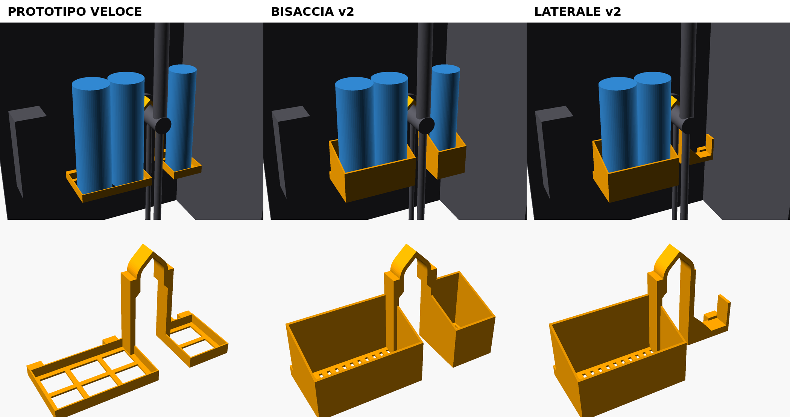
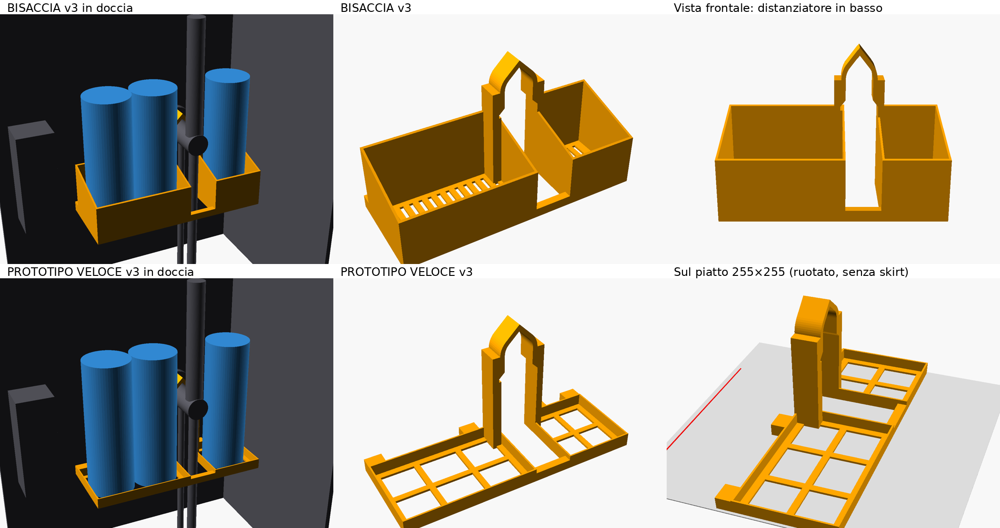
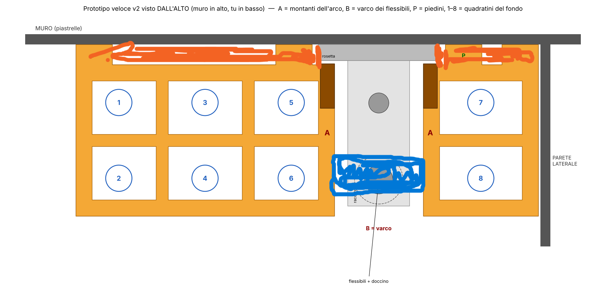
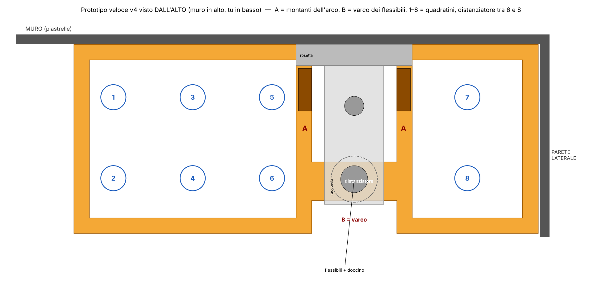
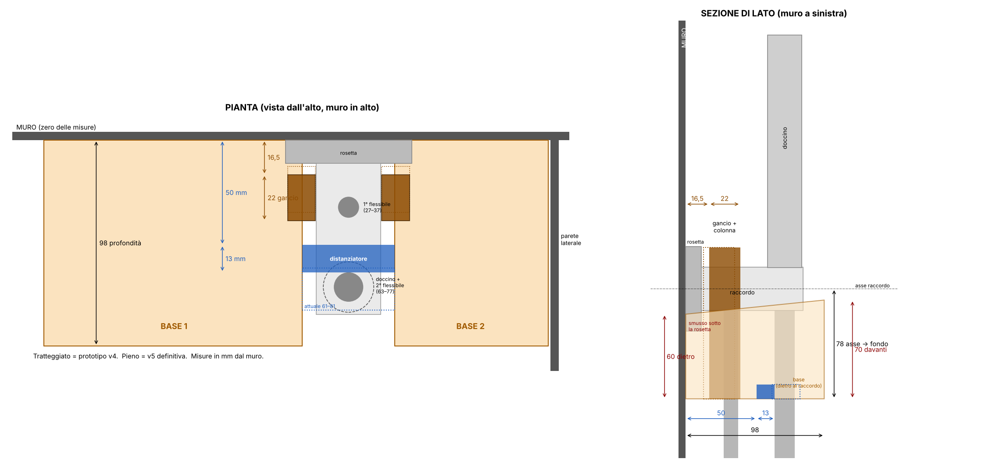
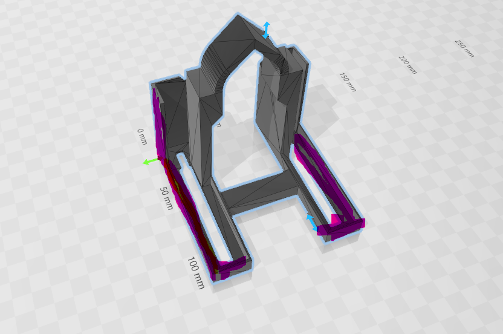
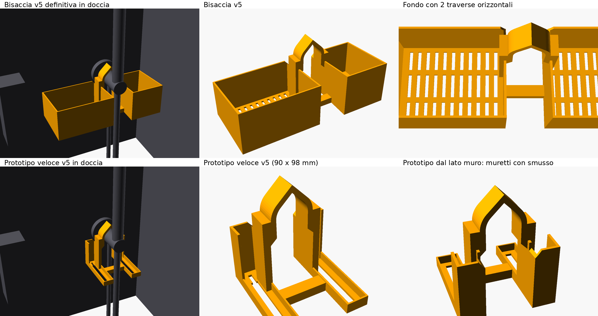

# 2. Design history

Each version below is in `models/vN/`. Each folder holds the OpenSCAD source (`shower_holder_vN.scad`), the exported STLs, the renders and, for v1–v3, the original Italian notes that came with that version (`README_original_it.txt`).

| Version | Date (2026) | Main idea | Printed? |
|---|---|---|---|
| v0 | before 28 Oct | Closed box slid onto the fitting | No |
| v1 | 28 Oct | Hook test + three concepts | No (concepts only) |
| v2 | 28 Oct | Teardrop hook, central hose gap, "saddlebag" layout | Quick prototype, tested 29 Oct |
| v3 | 29 Oct | v2 resized + spacer in front | No: replaced by v4 |
| v4 | 29 Oct → 15 Nov | Restart from v2 following a hand-drawn plan | Quick prototype, night of 15–16 Nov |
| v5 | 16 Nov | Final adjustments after the v4 test | Quick prototype and **final part**, 16–17 Nov |

---

## v0: the original idea

`models/v0-original-idea/bathroom_first_idea.stl`

The project started from a quick model made beforehand: a box with a closed Ø 44 mm hole meant to slide over the fitting. It could not work:

- It could only go on from the **tip** of the fitting, where the hand-shower holder sits.
- It would hang **cantilevered**, with all the torque on the fitting.
- There was only **0.5 mm of material** above the hole.
- The floor was solid, so water could not drain.

## v1: hook test and three concepts

`models/v1/`: `hook_test.stl`, `design_bridge.stl`, `design_saddlebag.stl`, `design_side.stl`

- **Hook test** (`hook_test.stl`, about 40 g): three short hooks made for diameters 29.6 / 30.6 / 32.1 mm. The point was to check which one dropped onto the fitting without forcing and without play before printing anything big. The 30.6 mm value was kept.
- **Bridge**: the roomiest design. It slid onto the fitting from the tip after removing the hand shower. It was **discarded** once the photos showed the hand shower standing on a holder at the tip of the fitting.
- **Saddlebag**: two compartments, one on each side of the hoses, lowered onto the fitting from above. This became the base for everything that followed.
- **Side**: everything on the left, with only a strut on the right pushing against the side wall.

In all three, the weight pushes the back feet against the tiles and the right side against the side wall. The fitting carries only the vertical load.

## v2: first printable layout

`models/v2/`: `quick_prototype_v2.stl`, `saddlebag_v2.stl`, `side_v2.stl`

New input: the hose positions measured along the fitting (16–26 mm and 52–66 mm from the rosette).

- **Teardrop arch** instead of a round one. A round arch printed standing up has a flat, unsupported top. A teardrop never exceeds a 45° overhang, so it prints without supports. It also sits on the fitting along two 45° lines and centres itself.
- The hook sits between 1.5 and 23.5 mm from the rosette: on top of the fitting, clear of the hand shower.
- Pillars step inwards under the fitting with a **45° chamfer** instead of a flat ledge.
- A layer-by-layer check confirmed that **no island starts in mid-air**: every part grows from the bed.
- A 44 mm central gap for the hoses.
- **Quick prototype**: a lighter frame of the saddlebag with the same hook geometry (`gcode/v2_quick_prototype.gcode`, 0.28 mm layers, 6 h 09, 21.6 m).

**Test of the v2 prototype (29 Oct):**

- The hook fitted the fitting well, which confirmed the 30.6 mm diameter.
- The back feet stopped **3 mm** short of the tiles: the rosette is thicker than estimated.
- The right side stopped **16 mm** short of the side wall.
- Under load, **the two compartments swung towards each other**: the arch flexed.

## v3: resize + spacer in front (not adopted)

`models/v3/`

- Left compartment +5 mm per side (inside 133 × 80 mm). The back could not move, so the extra depth all went to the front.
- Back feet +3 mm, right side +16 mm (it now touches the side wall).
- A **10 × 8 mm spacer bar** at the bottom front, about 9 cm from the wall, in front of the hoses and the hand shower. It stops the compartments from swinging inwards.
- The first **beam model** of the frame was built for this version (see [structural analysis](04-structural-analysis.md)).

Nico preferred to restart from v2 and described the changes he wanted with a drawing, so v3 was never printed.

## v4: restart from v2, following a hand-drawn plan

`models/v4/`

Changes taken from the drawing:

- **Base 1 (left)**: +5 mm to the left and +10 mm in depth. Its inner side moved to 22 mm from the axis, like base 2, with the wall inside the column (the column was **mirrored** from the right side).
- **Base 2 (right)**: +16 mm towards the side wall.
- **No feet**: the floor and back wall run straight to the tiles across the whole width, including under the rosette.
- **Floor-level spacer** between base 1 and base 2, across the hose gap and centred on the front row of the compartments, instead of the v3 bar in front.
- Base 1 shortened by 10 mm at the left end: overall length **240 mm**, so it fits along the 255 mm bed.
- Quick prototype: empty floors and **columns 30 mm lower**, to save time.

Several rounds of corrections were needed to get the drawing right. They are listed in [mistakes](03-mistakes-and-lessons.md#misreading-the-change-requests).

**Test of the v4 prototype** (night of 15–16 Nov, `gcode/v4_quick_prototype.gcode`, 4 h 41, 17.7 m): the print came out well. Feedback:

- The spacer was too far forward. It had to sit between about 50 and 63 mm from the wall, behind the hand-shower hose.
- The hook and columns had to move **4 mm** further from the wall.
- The arch height was confirmed.

## v5: final

`models/v5/`

Changes after the v4 test:

- **Spacer** from 50 to 63 mm from the wall, 10 mm high. After the v5 prototype it was widened by 1 mm towards the wall and 0.5 mm outwards, to **49–63.5 mm**.
- **Hook and columns 4 mm further out**: 16.5–38.5 mm from the wall.
- Floor at the prototype's height, 78 mm below the fitting axis. Part height 107 mm.
- **Walls lower at the back (60 mm) and higher at the front (70 mm)**: the top edge slopes as a plane.
- The corner under the rosette is **chamfered following the rosette**: a cylinder of radius 33 mm (rosette + 3 mm). After the prototype it was lowered by another 2 mm.
- **Two horizontal crossbars** (6 mm) across the slotted floors stiffen them.
- **Quick prototype v5**: only the central part (hook, columns, spacer, short base segments and two small walls with the rosette chamfer), about 85 × 90 mm. Areas marked in magenta on a Cura screenshot were removed:

  

- Final checks before export:
  - closed meshes;
  - no islands;
  - no overhang beyond 46° larger than about 0.4 mm²;
  - no contact with the fitting, the rosette, the first hose or the walls along the whole mounting path;
  - the spacer touches the *estimated* position of the hand-shower hose by 0.5 mm, but its limits come from Nico's own measurements on the prototype, so those were kept.

**How to mount it:** hold the caddy 2–3 cm above its final position with the hook over the fitting near the rosette, move it against the wall, then lower it. The spacer and the tube block a straight vertical drop, so the caddy goes on high first and then down. The hoses stay in the central gap behind the spacer.

**Prints:**

- Quick prototype v5 on 16 Nov: 0.32 mm layers, 2 h 49 estimated, 11.5 m. It was stopped by hand at 98.9 %.
- Final part 16–17 Nov: about 17 h. Details in [printing](05-printing.md).
