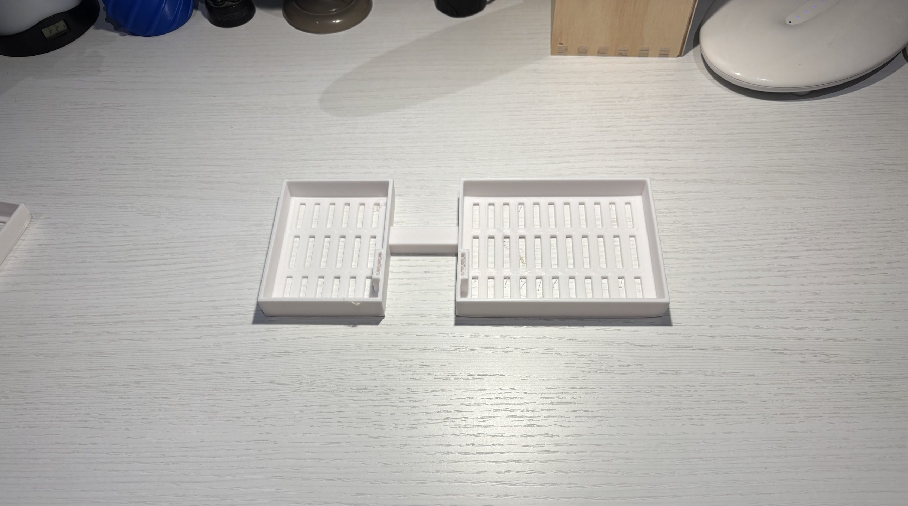
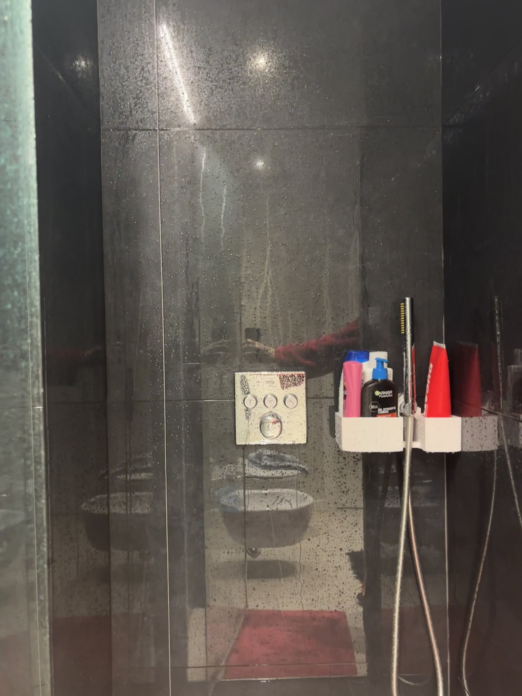
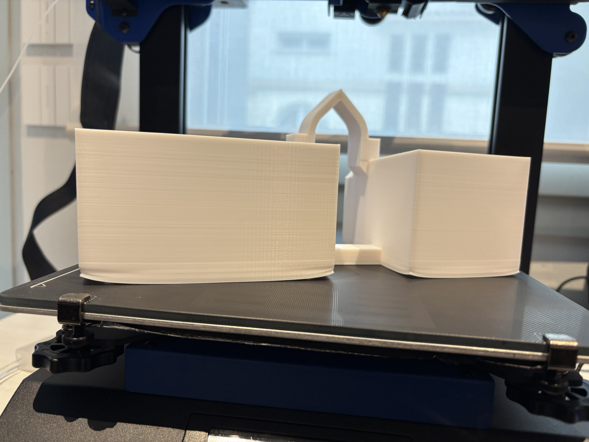
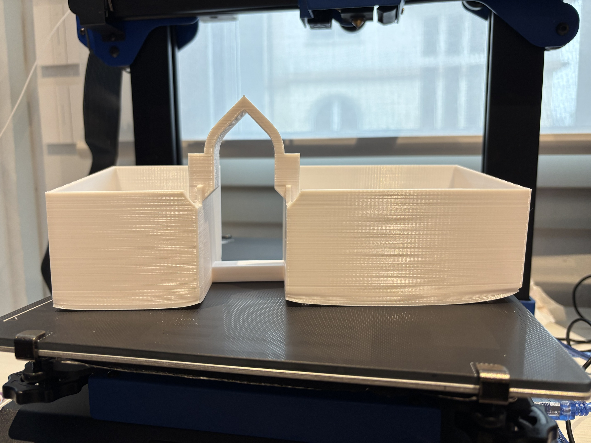
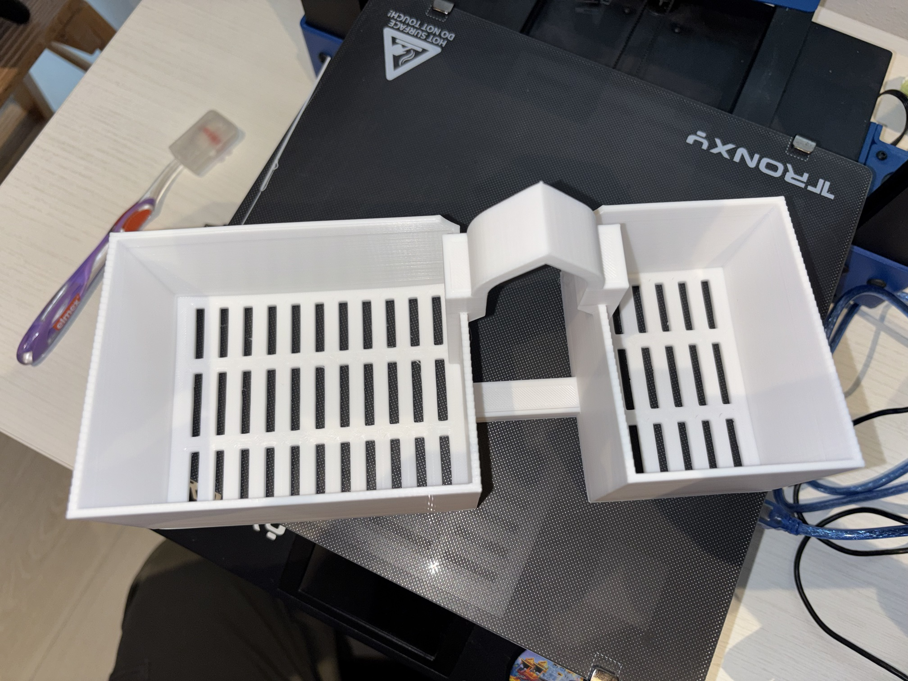
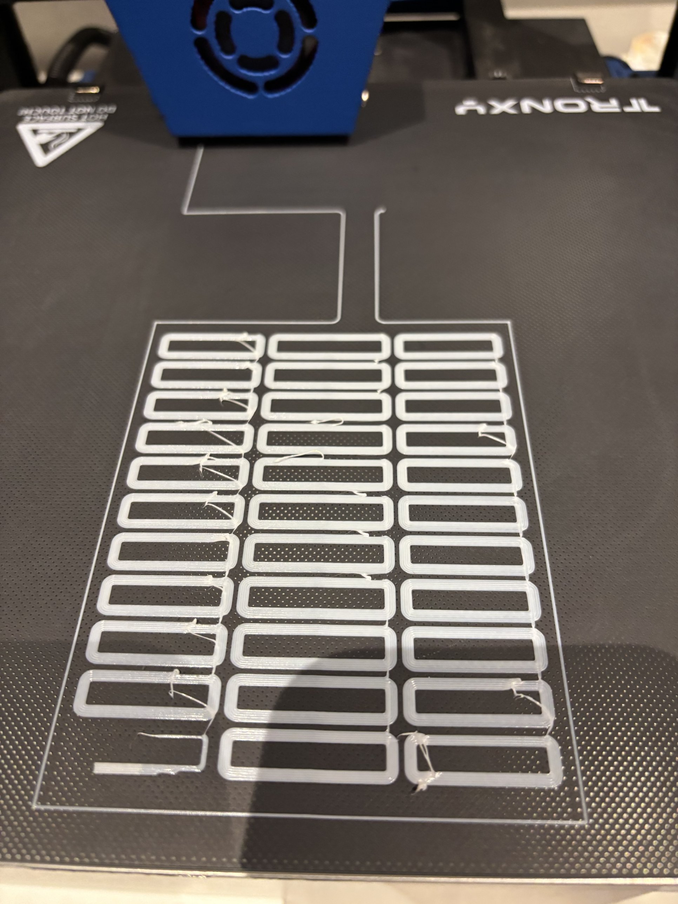

# 5. Printing

## Printer and software

| | |
|---|---|
| Printer | Tronxy XY-3 SE, 255 × 255 × 260 mm, 0.4 mm nozzle, Bowden extruder |
| Firmware | Marlin 2.1.1. Maximum extruder speed 40 mm/s, so retraction speeds above that are capped |
| Slicer | Cura 5.13 (profile based on the Tronxy XY-2 Pro, hence the `TXY2PROPRO2EXY3SE_` prefix and `TARGET_MACHINE.NAME:Tronxy XY-2 Pro` in the G-code) |
| Material | White PLA+, 1.75 mm |
| Start code | Heats the bed and nozzle during homing and turns on the saved bed mesh (`M420 S1`). The nozzle waits 15 mm above the bed, then is primed 8.5 mm and draws a two-line purge at X = 5 |
| End code | Nozzle off, extra 2 mm retraction, wipe, park at Z = 170 |
| Sending | USB from a laptop through a small Python host program with a web panel and webcam recording (not part of this repository) |

All G-code files in [`gcode/`](../gcode) are the exact files that were printed.

## Prints

| File | Part | Layer | Cura estimate | Filament | Result |
|---|---|---|---|---|---|
| `v2_quick_prototype.gcode` | v2 frame | 0.28 mm | 6 h 09 | 21.6 m | Fit test: see [history](02-design-history.md#v2-first-printable-layout) |
| `v4_quick_prototype.gcode` | v4 central part, low columns | 0.28 mm | 4 h 41 | 17.7 m | Printed well (night of 15–16 Nov) |
| `v5_quick_prototype.gcode` | v5 central part | 0.32 mm | 2 h 49 | 11.5 m | Printed well, stopped by hand at 98.9 % (16 Nov) |
| `v5_final.gcode` | **v5 final** | 0.24 mm | 17 h 08 | 68.9 m | **Success** (16–17 Nov). Corners warped, details below |

There was also an **interrupted attempt** at the final part. The filament had **tangled on the spool**, and the knot stopped the extruder from pulling it. The print had to be stopped by hand and the knot cut out. By then only the floors, the low walls, the spacer and the bottom of the two columns were done:

## Quick prototypes

The quick prototypes are meant to check the fit, not to last. To save time:

- Layer 0.28 mm, or 0.32 mm if speed matters most. On a 0.4 mm nozzle about 0.30–0.32 mm is the practical maximum, and the 45° slopes of the arch come out rougher.
- 2–3 walls, 10–15 % infill.
- No supports, no skirt.
- The Z-offset does **not** depend on layer height: the first layer stays at 0.3 mm.

## Final part: settings actually used

From the analysis of `v5_final.gcode` (with `tools/gc.py`):

| Setting | Value |
|---|---|
| Orientation | As exported (`print_final_v5.stl`, already rotated; long side along Y) |
| Layer height | 0.24 mm (first layer 0.3 mm), 447 layers, max Z 107.34 mm |
| Walls | 6 (2.4 mm, solid walls) |
| Top / bottom | 4 layers each |
| Infill | 20 % |
| Supports / adhesion | None / none (no skirt: the part covers Y 7.7–247.3 mm, so there is no room) |
| Nozzle | 215 °C first layer, 210 °C after |
| Bed | 75 °C for the whole print |
| Fan | 0 % on the first layer, then 33 / 67 / 100 % from layer 4 |
| Speeds | Walls 45 mm/s, top/bottom 30, infill 60, first layer 20 |
| Retraction | 5.8 mm at 40 mm/s; combing "All" |
| Footprint | X 78.7–176.3, Y 7.7–247.3: inside the 0–255 limits, with the purge line well away from it |

**What I would change next time:**

- **Nozzle 220–225 °C** (then 220 °C) for better layer bonding: 210 °C is the bottom of the PLA+ range.
- **5 mm brim** against warping. It fits: Y 2.7–252.3 mm.
- Fan at most **50 % for the first ~10 layers**, and no draughts (the printer stands near a window).
- **Skin overlap 15–20 %** to close the gap between walls and top skin.
- PETG for permanent use in the shower.

## Final print quality

**Good:**

- Clean walls and regular layers. No layer shifts, no gaps.
- The teardrop arch printed without supports, including the tip.
- Clean drainage slots without strings.
- The top edge of the walls is slightly stepped. This is expected: the edge rises 10 mm over 98 mm, so each 0.24 mm layer makes a visible step about 2.4 mm long.

**Problems:**

1. **Warping.** The far corners of both compartments lifted a few mm off the bed; the base touches in the middle and curves up at the ends. The causes are a large, solid 240 × 98 mm base with 6 tall walls shrinking as they cool, no brim, and the fan at 100 % from layer 4 near a window. **In use it hardly matters**: the floor does not rest on anything. The only check is that the back edge still touches the tiles once mounted.
2. **Thin line on top of the spacer.** It runs between the wall lines and the diagonal top skin. It is *not* in the model: the spacer is a plain 46 × 14.5 × 10 mm block, with the same height over its whole depth. Cura prints the walls first and then the skin, and the default skin overlap is only 5 % (about 0.02 mm), so the two barely fuse. The skin shrinks slightly as it cools. It only affects the top surface, not strength.
3. **Stringing on the first layer.**

   

   Of 406 travel moves longer than 1 mm on layer 0, only 55 retracted. With combing set to "All", Cura does not retract while the path stays inside the part outline, and the space between the rectangles counts as inside because the bottom skin fills it straight after. First-layer travel is also slow (30 mm/s), at the hottest nozzle temperature of the print. The strings all start at the same corner of each rectangle, where the wall loop ends. **They do not affect strength:** the skin lines of the same layer and the next 3 bottom layers bury them.
4. **Weight.** Cura estimated 206 g; the part weighs **about 190 g** on a kitchen scale. Cura does not weigh anything: it multiplies the filament length (68.9 m) by the cross-section of a 1.75 mm filament and a density of 1.24 g/cm³. An 8 % difference is typical:
   - filament slightly thinner than nominal (1.72 mm is already −3.5 %);
   - a lower real density for PLA+ (about 1.20–1.23);
   - perhaps slight under-extrusion.

   To rule out under-extrusion, measure a compartment wall with calipers: it should be about 2.4 mm. Below 2.2 mm, calibrate the extruder before the next load-bearing print.
